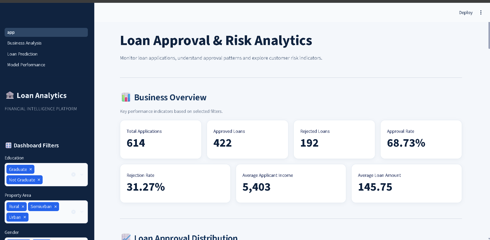
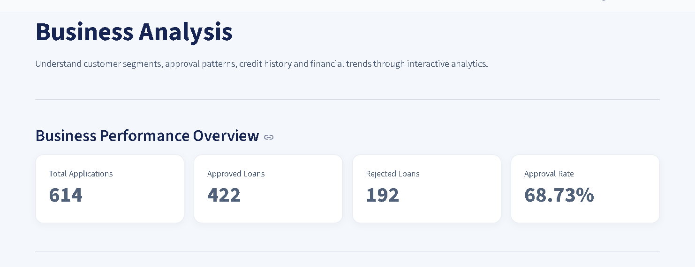
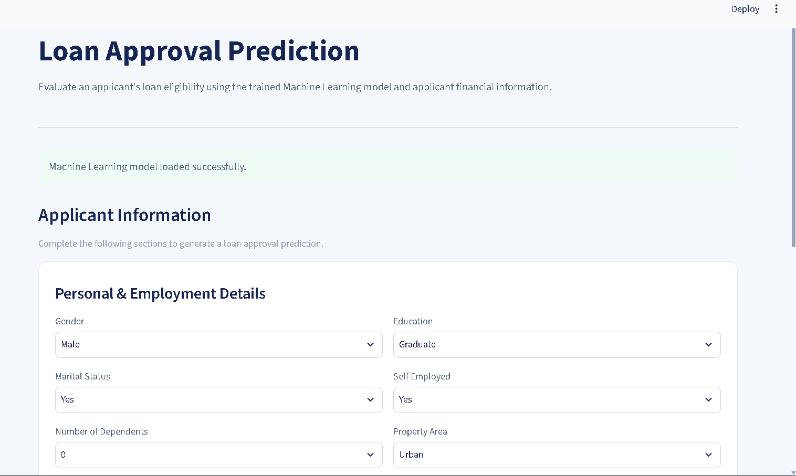
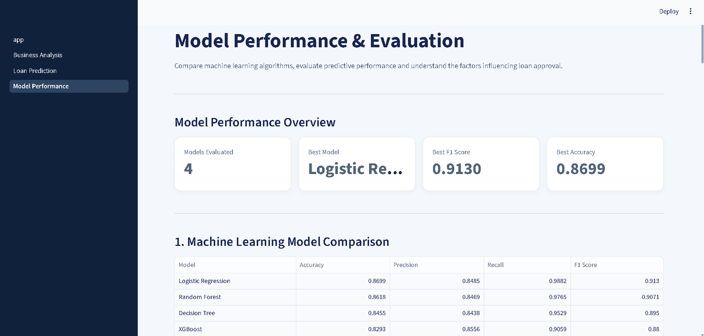

\# Loan Approval \& Risk Analytics


\## 📊 Project Overview


\*\*Loan Approval \& Risk Analytics\*\* is an end-to-end Data Analytics and Machine Learning project designed to analyze loan applications, identify major factors affecting loan approval, evaluate applicant risk, and predict loan approval outcomes.


The project combines data analysis, business intelligence, SQL, machine learning, and an interactive Streamlit dashboard into a single analytics solution.


\### Project Workflow


```text

Raw Data

&#x20;  ↓

Data Understanding

&#x20;  ↓

Data Cleaning

&#x20;  ↓

Exploratory Data Analysis

&#x20;  ↓

Business Analysis

&#x20;  ↓

Feature Engineering

&#x20;  ↓

Machine Learning

&#x20;  ↓

Model Evaluation

&#x20;  ↓

SQL Analysis

&#x20;  ↓

Interactive Dashboard

&#x20;  ↓

Loan Prediction

```


\---


\## 🎯 Business Problem


Financial institutions receive a large number of loan applications and need to determine which applications are likely to be approved.


The objective of this project is to:


1\. Analyze historical loan applications.

2\. Identify important factors affecting loan approval.

3\. Understand applicant risk patterns.

4\. Perform business-oriented analysis using SQL and Python.

5\. Compare multiple Machine Learning models.

6\. Build an interactive analytics dashboard.

7\. Predict loan approval outcomes for new applicants.


\---


\## 🚀 Key Features


\### 1. Overview Dashboard


The main dashboard provides:


\- Total loan applications

\- Approved applications

\- Rejected applications

\- Overall approval rate

\- Approval distribution

\- Credit history analysis

\- Education analysis

\- Property area analysis

\- Applicant income analysis

\- Loan amount analysis

\- Interactive filters

\- Filtered data download


\### 2. Business Analysis


The Business Analysis dashboard provides deeper insights into:


\- Education

\- Property Area

\- Gender

\- Marital Status

\- Credit History

\- Applicant Income

\- Coapplicant Income

\- Loan Amount

\- Dependents

\- Self Employment


\### 3. Loan Prediction


Users can enter applicant information and receive:


\- Loan approval prediction

\- Approval probability

\- Rejection probability

\- Applicant summary


\### 4. Model Performance


The project compares multiple Machine Learning models:


\- Logistic Regression

\- Decision Tree

\- Random Forest

\- XGBoost


Model performance is evaluated using:


\- Accuracy

\- Precision

\- Recall

\- F1 Score

\- ROC-AUC


The dashboard also provides feature importance analysis.


\---


\## 📈 Key Business Insights


\### Credit History


Credit history is one of the strongest factors associated with loan approval.


Applicants with a positive credit history have a significantly higher approval rate compared with applicants having a negative credit history.


\### Education


Graduate applicants have a higher loan approval rate compared with non-graduate applicants.


\### Property Area


Semiurban applicants have the highest approval rate among the three property-area categories.


\### Loan Amount


Very large loan applications show a comparatively lower approval rate than smaller loan applications.


\### Income


Loan approval rates remain relatively stable across different applicant-income groups, indicating that income alone does not determine loan approval.


\---


\## 🤖 Machine Learning


Four classification models were trained and evaluated:


| Model | Purpose |

|---|---|

| Logistic Regression | Baseline and interpretable classification |

| Decision Tree | Rule-based classification |

| Random Forest | Ensemble-based classification |

| XGBoost | Gradient boosting classification |


\### Model Evaluation


The models were evaluated using:


\- Accuracy

\- Precision

\- Recall

\- F1 Score

\- ROC-AUC


\### Best Performing Model


Based on the evaluation performed in this project, \*\*Logistic Regression\*\* achieved the highest F1 Score among the evaluated models.


The trained models are stored in the `models/` directory.


The final model is:


```text

models/final\_loan\_model.pkl

```


\---

---

## 📸 Dashboard Screenshots

### 1. Overview Dashboard


### 2. Business Analysis


### 3. Loan Prediction


### 4. Model Performance


---


\## 📁 Project Structure


```text

Loan-Risk-Analytics/

│

├── app.py

├── README.md

├── requirements.txt

│

├── data/

│   ├── loan\_train.csv

│   ├── loan\_cleaned.csv

│   ├── loan\_eda\_data.csv

│   ├── loan\_ml\_ready.csv

│   ├── train\_data.csv

│   ├── test\_data.csv

│   ├── model\_comparison.csv

│   ├── model\_evaluation.csv

│   ├── feature\_importance.csv

│   └── cleaning\_summary.csv

│

├── models/

│   ├── best\_loan\_model.pkl

│   └── final\_loan\_model.pkl

│

├── notebooks/

│   ├── 01\_data\_understanding.ipynb

│   ├── 02\_data\_cleaning.ipynb

│   ├── 03\_eda\_business\_analysis.ipynb

│   ├── 04\_feature\_engineering.ipynb

│   ├── 05\_model\_training.ipynb

│   └── 06\_model\_evaluation.ipynb

│

├── pages/

│   ├── 1\_Business\_Analysis.py

│   ├── 2\_Loan\_Prediction.py

│   └── 3\_Model\_Performance.py

│

├── sql/

│   └── loan\_analysis.sql

│

└── .streamlit/

&#x20;   └── config.toml

```


> Note: The local `venv/` and `\_\_pycache\_\_/` folders are not included in the project repository.


\---


\## 🛠️ Technology Stack


\### Programming Language


\- Python


\### Data Analysis


\- Pandas

\- NumPy


\### Data Visualization


\- Plotly

\- Streamlit


\### Machine Learning


\- Scikit-learn

\- XGBoost

\- Joblib


\### Database


\- MySQL


\### Development Tools


\- Jupyter Notebook

\- VS Code

\- PowerShell


\---


\## ⚙️ Installation


\### 1. Clone the Repository


```bash

git clone <YOUR\_GITHUB\_REPOSITORY\_URL>

```


\### 2. Move into the Project Directory


```bash

cd Loan-Risk-Analytics

```


\### 3. Create a Virtual Environment


```bash

python -m venv venv

```


\### 4. Activate the Virtual Environment


For Windows PowerShell:


```powershell

.\\venv\\Scripts\\Activate.ps1

```


\### 5. Install Required Libraries


```bash

pip install -r requirements.txt

```


\---


\## ▶️ Run the Application


Start the Streamlit dashboard using:


```bash

python -m streamlit run app.py

```


The application will open in your web browser.


\---


\## 🗄️ SQL Analysis


MySQL was used to perform business-oriented analysis of loan applications.


The SQL analysis includes:


\- Overall loan approval rate

\- Credit history vs loan approval

\- Education vs loan approval

\- Property area vs loan approval

\- Applicant income analysis

\- Coapplicant income analysis

\- Loan amount analysis

\- Marital status analysis

\- Dependents analysis

\- Employment analysis


SQL script:


```text

sql/loan\_analysis.sql

```


\---


\## 📊 Dashboard Pages


\### 🏠 Overview Dashboard


Provides a high-level summary of loan applications, approval rates, applicant characteristics, and key business metrics.


\### 📈 Business Analysis


Provides detailed business insights using interactive filters and visualizations.


\### 🔮 Loan Prediction


Allows users to enter applicant details and generate a loan approval prediction.


\### 🤖 Model Performance


Provides:


\- Model comparison

\- Accuracy

\- Precision

\- Recall

\- F1 Score

\- ROC-AUC

\- Best model identification

\- Feature importance

\- Top important features


\---


\## 📥 Data Outputs


The project generates several processed datasets and analytical outputs:


| File | Purpose |

|---|---|

| `loan\_cleaned.csv` | Cleaned dataset |

| `loan\_eda\_data.csv` | EDA dataset |

| `loan\_ml\_ready.csv` | Machine Learning-ready dataset |

| `train\_data.csv` | Training dataset |

| `test\_data.csv` | Testing dataset |

| `model\_comparison.csv` | Model performance comparison |

| `model\_evaluation.csv` | Detailed model evaluation |

| `feature\_importance.csv` | Feature importance results |

| `cleaning\_summary.csv` | Data cleaning summary |


\---


\## 🔮 Future Improvements


Future versions of this project can include:


\- Real-time MySQL integration

\- Advanced applicant risk scoring

\- Explainable AI using SHAP

\- Automated model retraining

\- Cloud deployment

\- User authentication

\- Real-time loan application API

\- Advanced fraud detection

\- Customer segmentation

\- Automated business reports

\- Model monitoring and drift detection


\---


\## 👨‍💻 Author


\*\*Prince Chaurasiya\*\*


MCA Student | Data Analytics | Machine Learning | Data \& AI


\---


\## ⭐ Project Highlights


This project demonstrates an end-to-end Data Analytics and Machine Learning workflow covering:


\- Data Cleaning

\- Exploratory Data Analysis

\- Business Analytics

\- SQL

\- Feature Engineering

\- Machine Learning

\- Model Evaluation

\- Interactive Data Visualization

\- Predictive Analytics

\- Streamlit Dashboard Development


The project is designed as a portfolio project to demonstrate practical Data Analyst and Machine Learning skills.


\---


\## 📌 Disclaimer


This project is created for educational and portfolio purposes.


The predictions generated by the Machine Learning model should not be considered actual financial or lending decisions.

